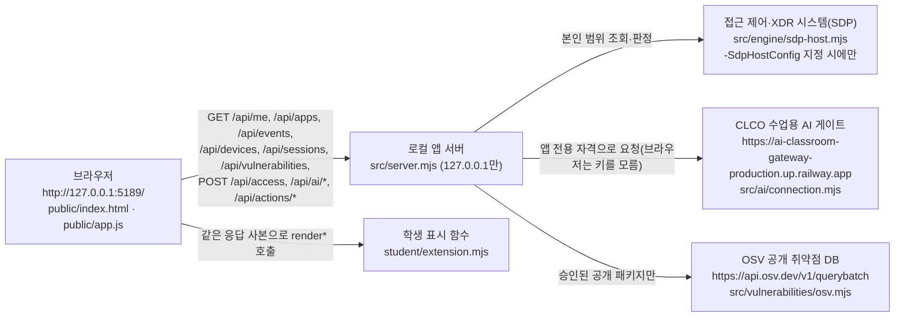

# NIN 학생 실행 설명서와 구성도

학생 작성 문서입니다(21단계). 제공 문서(README.md 본문, docs/ 아래 기존 문서)는 고치지 않았습니다. 비밀값(키·토큰·인증서·설정 파일 내용)은 이 문서에 적지 않습니다.

- 앱 이름: 「NIN」(포털에서 정한 이름). 제공 코드와 실행 창은 시작 틀 이름 「케셰브」로 표시합니다.
- 시작 틀: `alekov-client-starter` 0.2.11 (`package.json`)
- 저장소: https://github.com/superblueskt-netizen/nin-security-agent

확인 표시는 세 가지로 나눕니다.

| 표시 | 뜻 |
|---|---|
| 코드 확인 | 이 저장소의 파일을 읽고 대조했습니다. 실행하지 않았습니다. |
| 작업 환경 실행 | 수업용 AI 작업 환경(Linux, Node.js v22.23.2)에서 2026-10-26에 실제로 실행했습니다. 학생 PC(Windows) 결과가 아닙니다. |
| 미확인 | 학생 PC에서 아직 확인하지 않았습니다. 확인하면 이 표를 고칩니다. |

## 1. 목적과 기능

직원이 자기 로그인 상태, 업무 앱 접속 판정, 최근 접속·XDR 기록, 앱 안 AI 설명, 보안 조치 상태, 설치 패키지의 알려진 취약점 조회 결과를 보는 보안 앱입니다. 제공 화면이 서버 응답을 받아 보여 주고, 같은 응답을 학생 함수(`student/extension.mjs`)에도 넘겨 학생 칸에 따로 표시합니다.

## 2. 필요 프로그램과 버전

| 항목 | 기준 | 근거 | 확인 |
|---|---|---|---|
| Node.js | 22~24 지원, 수업 기준 24.19.0 | `package.json`의 `engines.node`, `tools/start-alekov.ps1`의 버전 검사 | 학생 PC 버전: 미확인(`node -v`로 확인) |
| npm 의존성 | 없음. `package-lock.json`도 없으며 `npm install`이 필요 없습니다 | `package.json`에 dependencies 없음 | 코드 확인 |
| PowerShell | Windows 기본 PowerShell | `tools/start-alekov.ps1` | 미확인 |
| 브라우저 | PC 브라우저 | 서버가 `127.0.0.1`에만 열림(`src/server.mjs`) | 미확인 |

Node.js 22에서는 실행 창에 `ExperimentalWarning: SQLite is an experimental feature` 경고가 보였습니다(작업 환경 실행). 동작을 멈추는 오류는 아닙니다.

## 3. 폴더 구조

이 PC에서는 `C:\Users\user\Desktop\on-client`가 앱 폴더이면서 Git 최상위 폴더입니다(`.git`이 이 폴더에 있음). 제공 안내(STUDENT_LAUNCH_GUIDE.md)의 "프로젝트 폴더가 on-client의 상위" 구성과 다르므로, 커밋·push도 이 폴더에서 합니다.

```
on-client/
├─ package.json            제공 · 실행 스크립트(start, demo, check)
├─ .env.example            제공 · 비밀 없는 설정 견본(자동으로 읽히지 않음, 4장 참고)
├─ tools/start-alekov.ps1  제공 · 실행 도구(버전·폴더·포트 확인 후 서버 실행)
├─ src/server.mjs          제공 · 로컬 앱 서버(127.0.0.1:5189)
├─ src/engine/             제공 · SDP(접근 제어·XDR) 연결
├─ src/ai/                 제공 · CLCO 수업용 AI 게이트 연결
├─ src/vulnerabilities/    제공 · package-lock 선별과 OSV 조회
├─ src/actions/            제공 · 보안 조치 준비·집행·결과 조회
├─ public/                 제공 · 화면(index.html, app.js, vulnerabilities-view.mjs …)
├─ student/extension.mjs   학생 작성 · 13~20단계 표시 함수
├─ student/engine-adapter.mjs  제공 틀 · 기존 서버 연결 어댑터(수정 안 함)
├─ vendor/                 제공 · clco-http.mjs
└─ docs/                   제공 문서 + 이 문서(STUDENT_RUNBOOK.md, 학생 작성)
```

제공/학생 구분의 기준은 `.on-starter-manifest.json`의 `sourceHashes` 목록입니다. 목록에 있는 파일은 제공 파일이며, 그중 학생이 고친 것은 `student/extension.mjs`와 README.md 끝의 학생 부분뿐입니다.

## 4. 실행·종료·재실행

### PowerShell 여는 위치
파일 탐색기에서 `C:\Users\user\Desktop\on-client`를 열고 주소 표시줄에 `powershell`을 입력한 뒤 Enter를 누릅니다.

### 실행 명령

| 방법 | 명령 | 하는 일 | 확인 |
|---|---|---|---|
| 기본(권장) | `powershell -NoProfile -ExecutionPolicy Bypass -File .\tools\start-alekov.ps1` | Node 버전·폴더·포트 확인 뒤 `src/server.mjs` 실행 | 코드 확인 · 학생 PC 미확인 |
| npm | `npm start` | `node src/server.mjs` (사전 확인 없음) | 작업 환경 실행 |
| 예제 자료 | `npm run demo` 또는 실행 도구 뒤에 ` -Demo` | 예제 엔진으로 실행. 실제 연결이 아님 | 작업 환경 실행(`node src/server.mjs --demo`) |
| 문법 확인 | `npm run check` | `node --check student/extension.mjs` | 작업 환경 실행 |
| 다른 포트 | 실행 도구 뒤에 ` -Port 5190` | 5189를 다른 프로그램이 쓸 때 | 코드 확인 |

`-ExecutionPolicy Bypass`는 그 한 번의 실행에만 적용됩니다.

설정은 환경변수로만 읽습니다(`src/server.mjs`의 `process.env`). 서버는 `.env` 파일을 자동으로 읽지 않습니다. 쓰는 변수는 `ON_PORT`(기본 5189), `ON_ENGINE_ADAPTER`, `ON_PROJECT_DIRECTORY`, `ON_APPROVED_PUBLIC_PACKAGES`(기본 `[]`)이며, 조회 대상 경로와 허용 패키지는 운영자가 정합니다.

### 브라우저 주소와 정상 시작 신호
- 주소: `http://127.0.0.1:5189/` (포트를 바꿨으면 그 번호)
- 실행 도구 사용 시 창에 다음 두 줄이 나옵니다(`tools/start-alekov.ps1` 코드 확인).
  - `케셰브가 켜졌습니다. 브라우저에서 http://127.0.0.1:5189/ 을 여세요.`
  - `서버가 응답한 것만 확인했습니다. AI 연결 상태는 화면에서 따로 확인해 주세요.`
- `npm start`로 실행하면 서버가 `케셰브 연결 확인: http://127.0.0.1:5189`를, `npm run demo`는 `케셰브 예제: http://127.0.0.1:5189`를 출력합니다(작업 환경 실행, 포트만 바꿔서 확인).
- 화면 위쪽에 「보호 현황」「업무 앱」「보안 기록」 탭이 보이면 화면이 뜬 것입니다(미확인).
- 기본 실행은 연결 없음(disconnected)입니다. 작업 환경에서 `GET /api/me`는 `ENGINE_NOT_CONNECTED`, `GET /api/vulnerabilities`는 `not_configured`를 돌려줬습니다. 둘 다 실패가 아니라 정해진 미연결 상태입니다.

### 종료와 재실행
- 종료: 실행한 PowerShell 창에서 `Ctrl+C`. 브라우저 주소가 더 이상 열리지 않으면 종료된 것입니다. ` -Background`로 켰으면 안내된 프로세스 번호의 node를 작업 관리자에서 종료합니다.
- 재실행: 같은 폴더에서 같은 명령을 다시 실행합니다. 실행·종료는 파일을 바꾸지 않습니다.

## 5. 구성도



같은 내용을 글로 적으면 다음과 같습니다.

| 출발 | 도착 | 무엇을 | 실제 위치 | 기본 실행에서 |
|---|---|---|---|---|
| 브라우저 | 로컬 앱 서버 | 화면 자료 요청(HTTP JSON) | `public/app.js` → `src/server.mjs` | 동작(작업 환경 실행) |
| 브라우저(제공 화면) | 학생 표시 함수 | 받은 응답 사본으로 `render*` 호출, 반환 DOM을 학생 칸에 넣음 | `public/app.js`의 `renderStudent` → `student/extension.mjs` | 동작(코드 확인) |
| 로컬 앱 서버 | 접근 제어·XDR 시스템(SDP) | 로그인·기기·세션·앱 판정·기록 | `src/engine/sdp-host.mjs`, `student/engine-adapter.mjs` | 연결 없음(`ENGINE_NOT_CONNECTED`) |
| 로컬 앱 서버 | CLCO 수업용 AI 게이트 | 연결 점검·사건 설명 | `src/ai/connection.mjs`, `vendor/clco-http.mjs` | 계정 연결·앱 승인 전에는 연결 안 됨 |
| 로컬 앱 서버 | OSV | 승인된 공개 패키지의 정확한 버전 조회 | `src/vulnerabilities/osv.mjs`, `project-scan.mjs` | 미조회(`not_configured`) |

AI 키·SDP 인증서는 서버 쪽 보관함과 운영자가 준 설정 파일에만 있고, 브라우저와 학생 함수로는 전달되지 않습니다(`docs/IMPLEMENTATION_CONTRACT.md`, `student/engine-adapter.mjs` 주석 코드 확인).

## 6. 제공 코드와 학생 작성 부분

| 단계 | 학생 함수(`student/extension.mjs`) | 무엇을 보여 주나 | 제공 쪽(고치지 않음) |
|---|---|---|---|
| 13 | `renderIdentity` | 현재 로그인 사용자·기기·세션과 상태 글자(보안 기준 충족/미충족/확인 불가, 활성/만료/철회됨) | `GET /api/me`, `/api/devices`, `/api/sessions` |
| 14 | `renderDecision` | 업무 앱 접근 판정 허용/거부/추가 확인 필요/확인 불가와 이유·시각. 요청 실패를 거부로 보이지 않게 함 | `POST /api/access`, 「업무 앱」 탭 |
| 15 | `renderEvents`(`createEventsRenderer`) | 접속 기록·XDR 경보 목록, 종류·앱·접속 상태 필터, 근거·규칙·상태 상세 | `GET /api/events`, 「보안 기록」 탭 |
| 16 | `renderStatus` | 등록 기기·현재 세션·알림·도움정보(허용된 6개 값만 복사) | 「도움정보 불러오기」, `GET /api/diagnostics` |
| 17 | `renderAiConnection` | AI 연결 점검 전/중/verified/test/오류 묶음별 안내 | 「AI 연결 점검」, `POST /api/ai/check` |
| 18 | `renderExplanation` | AI 사건 설명을 기록 근거 ID와 다시 대조해, 맞을 때만 요약·근거·확인 불가 상태·미실행 제안 표시 | 「AI 설명 취소」, `POST /api/ai/explain` |
| 19 | `renderAction` | 조치 준비·전달 중·접수(ACK)·효과 확인·결과 불명을 구분, 영수증과 현재 선택 대조 | 「대상과 조치를 확인했으며 집행합니다」「원천 결과만 재조회」「조치 화면 취소」, `/api/actions/*` |
| 20 | `renderVulnerabilities` | 조회 전/중/실패·취소, 전체 상태 5가지, lockfileVersion·lockfileHash·checkedAt, 패키지별 정확한 설치 버전·상태·출처·시각, 취약점 ID·modified | 「설치 패키지 조회」「패키지 조회 취소」, `GET /api/vulnerabilities`, `public/vulnerabilities-view.mjs` |

학생 함수는 표시만 합니다. 요청·버튼·취소·늦은 응답 버리기는 제공 `public/app.js`가 맡습니다. 19단계 학생 문구의 「연동 시스템 결과만 재조회」는 화면 버튼 「원천 결과만 재조회」를 가리킵니다.

## 7. 오류별 확인 순서

화면이나 실행 창에 실제로 나오는 문구 기준입니다. 더 많은 코드는 `docs/CONNECTION_TROUBLESHOOT.md`에 있습니다.

| 나오는 문구·코드 | 어디서 | 뜻 | 확인 순서 |
|---|---|---|---|
| `Node.js 가 없습니다` / `지금 Node.js 는 vXX 입니다` | 실행 창 | Node 없음·버전 범위 밖 | 1) `node -v` 2) 22~24(기준 24.19.0) 설치 3) 새 PowerShell 창에서 다시 실행 |
| `포트 5189 를 다른 프로그램이 쓰고 있습니다` | 실행 창 | 포트 충돌 | 1) 그 프로그램은 그대로 둠 2) ` -Port 5190`으로 실행 3) 브라우저도 `:5190` |
| `앱 폴더가 아닙니다` / `시작 틀 폴더가 아닙니다` | 실행 창 | 실행 위치 오류 | 1) 현재 폴더가 `on-client`인지 2) 바로가기가 아닌 실제 폴더인지 |
| `…초 안에 뜨지 않았습니다` | 실행 창 | 서버가 제때 응답 안 함 | 창 메시지 전체와 도움정보를 강사에게 |
| `ENGINE_NOT_CONNECTED`, 모드 「연결 없음」 | 보호 현황·업무 앱·보안 기록 | SDP 설정 없이 실행함(기본) | 실패 아님. 실제 연결은 담당자가 준 `-SdpHostConfig` 경로로만 |
| 「예제 자료」 | 모든 칸 | `--demo` 실행 | 실제 연결·성취로 보지 않음 |
| `CONTRACT_MISMATCH`, 「확인 불가」 | 기록·조회 칸 | 응답 형식을 믿을 수 없음 | 「다시 불러오기」 한 번 → 계속되면 도움정보를 담당자에게 |
| `ON_AI_PROVISIONING_PENDING` 「권한 준비 중·확인 불가」 | AI 연결 점검 | 계정 연결·앱 승인 미완료 또는 운영자 준비 전 | 1) 「계정 연결 시작」→「로그인 확인 완료」 2) 「AI 연결 시작」→「승인했으며 연결 확인」 3) 그래도면 담당자 |
| `WB_CLCO_TIMEOUT`, `WB_CLCO_NETWORK_ERROR` 등 | AI 연결 점검 | 게이트 연결 문제 | 인터넷 확인 → 잠시 뒤 직접 다시 점검(자동 재시도 없음) |
| `ON_AI_INVALID_OUTPUT` 「근거 불일치」 | AI 사건 설명 | AI가 이 기록에 없는 근거·조치를 인용 | 설명을 쓰지 않음. 기록은 그대로 사용 |
| 「결과 불명(unknown)」 | 조치 상태 | 전달됐을 수 있으나 효과 미확인 | 다시 집행하지 말고 「원천 결과만 재조회」 |
| 「조회 준비 미완료(not_configured)」 | 학생 패키지 조회 표시 | 조회 대상 프로젝트 설정 없음 | 실패·취약점 없음 아님. 운영자 설정 대기 |
| 「아직 조회 안 함(not_checked)」 | 학생 패키지 조회 표시 | 승인된 공개 패키지 없음 | 운영자 허용 목록 대기 |
| 「조회 실패」 / 「조회 취소」 | 학생 패키지 조회 표시 | 요청 실패·시간 초과·취소 | 이전 결과를 현재로 보지 않음 → 「설치 패키지 조회」를 직접 다시 누름 |

## 8. 확인한 것과 미확인(기다림·UNV)

| 기능 | 상태 | 비고 |
|---|---|---|
| `npm start`로 서버가 뜨고 `/` 가 HTTP 200 | 작업 환경 실행 | Linux·Node 22, 학생 PC 아님 |
| `--demo`에서 `/api/me`가 예제 사용자 반환 | 작업 환경 실행 | 예제 자료이며 실제 연결 아님 |
| 기본 실행에서 `/api/me` = `ENGINE_NOT_CONNECTED`, `/api/vulnerabilities` = `not_configured` | 작업 환경 실행 | |
| `npm run check` 통과 | 작업 환경 실행 | 문법만 확인 |
| 20단계 표시 함수의 상태별 문구·속성 | 모의 데이터 점검 | 작업 환경에서 가짜 DOM으로 확인 |
| 학생 PC에서 실행 도구로 켜기·끄기·다시 켜기 | 미확인 | 22단계 새 환경 기록에서 확인 예정 |
| 학생 PC 브라우저에서 13~20단계 학생 칸 표시 | 미확인 | |
| SDP 실제 연결(실제 사용자·기기·판정·기록) | 기다림(UNV) | 담당자 설정 파일 필요 |
| CLCO 계정 연결·AI 앱 승인·사건 설명 | 기다림(UNV) | 운영자 권한 발급 필요 |
| 보안 조치 실제 집행과 효과 관측 | 기다림(UNV) | 실행하지 않음 |
| OSV 실제 외부 조회 결과 | 기다림(UNV) | 허용 목록이 비어 있어 미조회. 결과가 없어도 안전 보장이 아님 |
